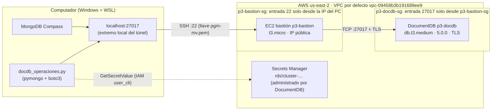

# Punto 3 – Diagrama de conexión a DocumentDB

DocumentDB solo es accesible **dentro de su VPC**, así que no se puede abrir desde internet. Para usarlo desde el computador (MongoDB Compass y Python) se montó un **túnel SSH** a través de una EC2 bastión que está en la misma VPC.

## Componentes y por qué se necesitan

| Componente | Configuración | Función |
|---|---|---|
| **EC2 bastión** `p3-bastion` | `t3.micro`, Amazon Linux 2023, subred pública de la VPC por defecto, **IP pública**, llave `pgm-mv` | Única máquina alcanzable desde internet; reenvía el tráfico hacia DocumentDB |
| **SG `p3-bastion-sg`** | Entrada: **SSH 22** solo desde la IP del PC (`/32`). Salida: todo | Nadie más puede entrar al bastión |
| **SG `p3-docdb-sg`** | Entrada: **TCP 27017** solo desde el **SG del bastión** (no desde una IP). Salida: todo | DocumentDB solo acepta conexiones que vienen del bastión |
| **DocumentDB** `p3-docdb` | 1 instancia `db.t3.medium`, motor 5.0.0, grupo de parámetros `default.docdb5.0` (**TLS obligatorio**), sin acceso público | La base de datos |
| **Túnel SSH** ([tunel.sh](tunel.sh)) | `ssh -i pgm-mv.pem -N -L 27017:<endpoint-docdb>:27017 ec2-user@<ip-bastión>` | Lo que llega a `localhost:27017` en el PC sale por el bastión hacia el endpoint de DocumentDB |
| **Certificado TLS** `global-bundle.pem` | Descargado de `truststore.pki.rds.amazonaws.com` | Permite validar el certificado de DocumentDB |
| **Secrets Manager** | Secreto `rds!cluster-…` creado y rotado por DocumentDB | Guarda usuario y contraseña; Python los lee con `GetSecretValue` (política `Punto3LeerSecretoDocDB`) |

## Parámetros de conexión (Compass y Python)

| Parámetro | Valor | Por qué |
|---|---|---|
| Host | `localhost:27017` | Se entra por el extremo local del túnel |
| `tls` | `true` | DocumentDB exige TLS |
| `tlsCAFile` | `global-bundle.pem` | CA de AWS para confiar en el certificado del servidor |
| `tlsAllowInvalidHostnames` | `true` | El certificado es para `*.docdb.amazonaws.com`, pero la conexión se hace a `localhost` |
| `directConnection` | `true` | Conectar directo al nodo sin descubrir el replica set (los nombres internos no resuelven desde el PC) |
| `retryWrites` | `false` | DocumentDB no soporta *retryable writes* |
| Usuario / contraseña | desde Secrets Manager | Nunca escritos en el código ni en `.env` |
