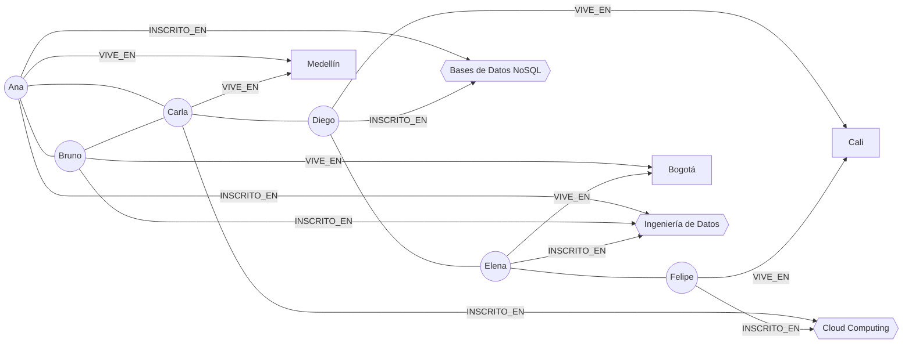
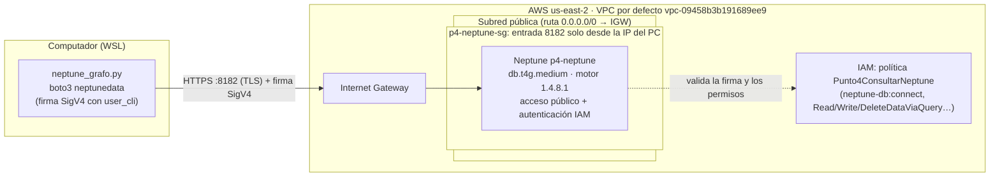

# Punto 4 – Modelo del grafo y arquitectura de acceso a Neptune

## Modelo del grafo (property graph)

Red de estudiantes: quién es amigo de quién, en qué ciudad vive cada uno y en qué cursos está inscrito.

**12 vértices · 19 aristas**

| Etiqueta (vértice) | Cantidad | Propiedades |
|---|---|---|
| `Persona` | 6 | `nombre`, `edad` |
| `Ciudad` | 3 | `nombre` |
| `Curso` | 3 | `nombre` |

| Relación (arista) | Cantidad | Dirección |
|---|---|---|
| `AMIGO_DE` | 6 | Persona → Persona (se consulta sin dirección) |
| `VIVE_EN` | 6 | Persona → Ciudad |
| `INSCRITO_EN` | 7 | Persona → Curso |

Todos los vértices llevan además `proyecto: 'p4'`, para poder borrar y volver a cargar solo los datos de este punto.

Las líneas sin flecha entre personas son las aristas `AMIGO_DE`.

### Consultas que recorren relaciones (openCypher)

| # | Pregunta | Recorrido |
|---|---|---|
| 1 | ¿A quién podría conocer Ana? (amigos de sus amigos que aún no son amigos suyos) | `Persona -AMIGO_DE- Persona -AMIGO_DE- Persona` (2 saltos) |
| 2 | ¿Quiénes son los compañeros de curso de Ana y dónde viven? | `Persona -INSCRITO_EN-> Curso <-INSCRITO_EN- Persona -VIVE_EN-> Ciudad` (3 saltos, 2 tipos de relación) |
| 3 | ¿Cuál es la cadena de amistad más corta entre Ana y Felipe? | `AMIGO_DE*1..6` (longitud variable) |

El código está en [neptune_grafo.py](neptune_grafo.py).

## Arquitectura de acceso: endpoint público + IAM

| Elemento | Configuración | Función |
|---|---|---|
| **VPC** | VPC por defecto `vpc-09458b3b191689ee9` | Red donde vive Neptune |
| **Subredes y rutas** | Subredes por defecto (públicas): su tabla de rutas tiene `0.0.0.0/0 → Internet Gateway` | Requisito del endpoint público: la instancia debe estar en subredes con salida a internet |
| **Instancia** | `--publicly-accessible` (acceso público = Sí) | Desde fuera de la VPC, el DNS del endpoint resuelve a una IP pública; desde dentro, a la privada |
| **Security group** `p4-neptune-sg` | Entrada TCP **8182** solo desde la IP pública del PC (`/32`) | Primera barrera: ninguna otra IP puede abrir conexión |
| **Autenticación IAM** | Activada en el clúster (obligatoria con endpoint público) | Segunda barrera: cada petición HTTP va firmada con SigV4; Neptune la rechaza si la identidad no tiene la política `neptune-db:*` |
| **TLS** | HTTPS en el puerto 8182 | Cifrado en tránsito |

### ¿Es necesario el proceso con EC2? ¿Existe otra manera?

**No es necesario.** Con Neptune 1.4.6 o superior, el **endpoint público** permite conectarse directo desde el PC, sin bastión, túnel ni llave SSH. Además de la EC2 con túnel SSH y del endpoint público, existen otras opciones: Neptune Workbench (notebooks dentro de la VPC), CloudShell en modo VPC, AWS Client VPN o una Lambda dentro de la VPC. Están explicadas en [consulta.md](consulta.md#4-cómo-consultar-neptune-desde-local).

| | Túnel SSH por EC2 | Endpoint público (elegido) |
|---|---|---|
| Recursos extra | EC2 + IPv4 pública + llave SSH | Ninguno |
| Costo extra | ≈ USD 0.016/h | USD 0 |
| Exposición | Neptune queda privado; se expone el puerto 22 del bastión | Se expone el puerto 8182 de Neptune, limitado por SG a una IP |
| Autenticación | La del clúster (IAM opcional) + llave SSH | IAM obligatoria (SigV4) |
| Complejidad | Túnel abierto mientras se trabaja; TLS con `localhost` | Conexión directa con el SDK |
